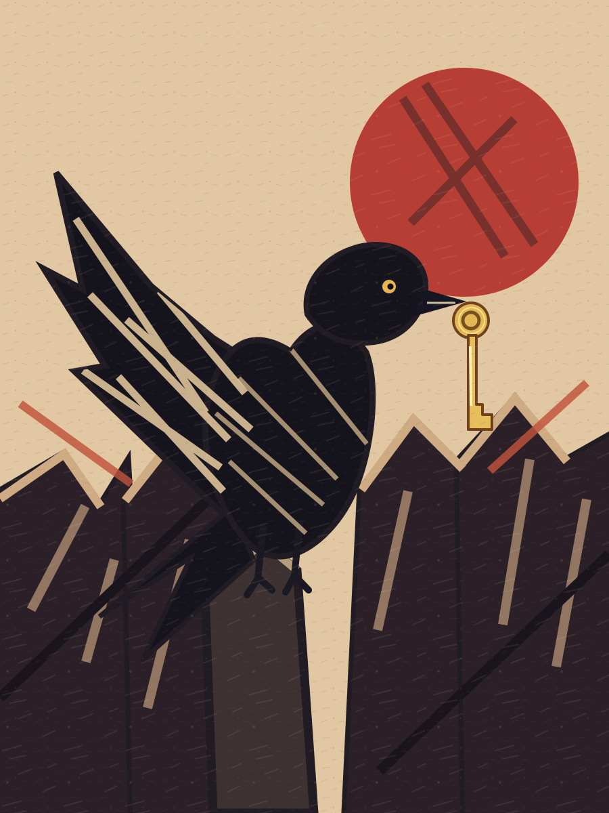
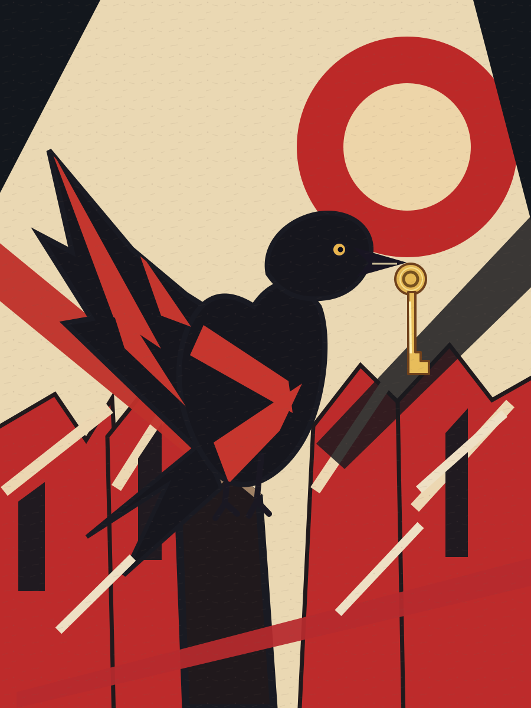
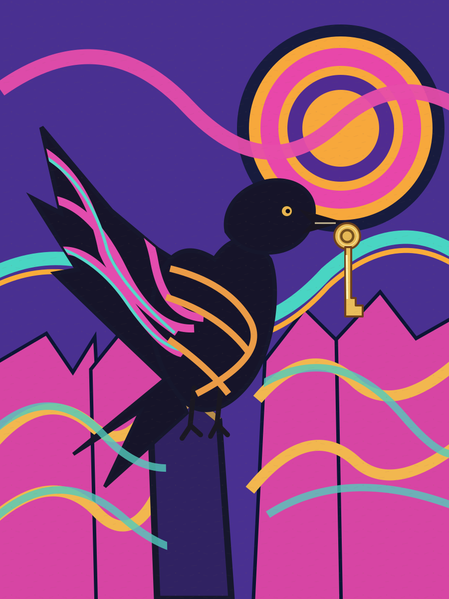
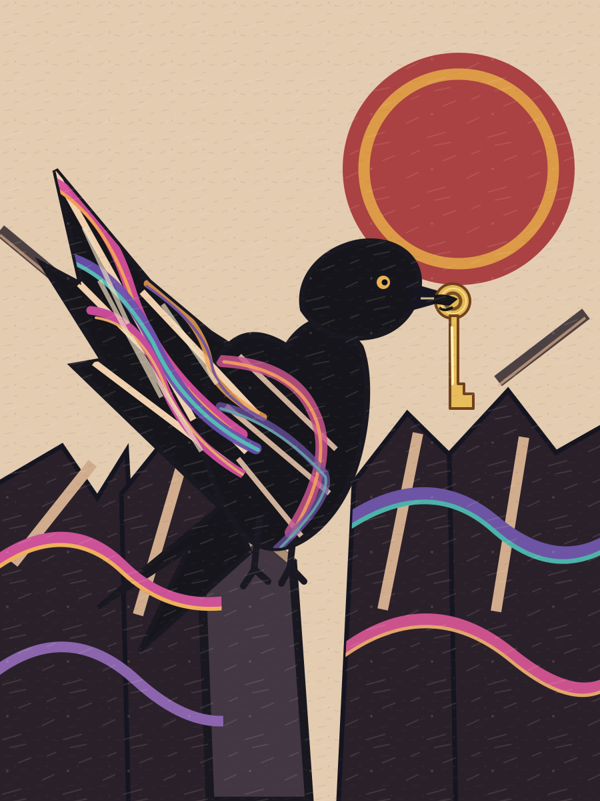

# Test 4: Raven, Golden Key and Unstable City

**Skill:** EXPLORE-VISUAL-STYLES v2.3.0

**Canonical task:** [SPEC-002-RAVEN-CITY.md](SPEC-002-RAVEN-CITY.md)  
**Implementation:** [IMPLEMENTATION.md](IMPLEMENTATION.md)  
**Verification:** [REVIEW.md](REVIEW.md) (v2: **9 pass / 2 partial / 0 fail**)  
**Pre-implementation analysis:** [ANALYSIS.md](ANALYSIS.md)

## Individual style studies

| German Expressionist | Soviet Constructivist | Psychedelic |
| --- | --- | --- |
| [Open SVG](images/01-german.svg) | [Open SVG](images/02-constructivist.svg) | [Open SVG](images/03-psychedelic.svg) |
|  |  |  |

## Hybrid implementation

**V1:** [Original](images/04-hybrid-v1.svg) (color bands floating outside the subject; failed AC-07).

**V2:** [Revised image](images/05-hybrid-v2.svg) (flowing color integrated into the raven and city).

The test demonstrates the spec → implementation → Acceptance Criteria review loop. **Full acceptance is not claimed:** AC-06 and AC-09 remain partial.
