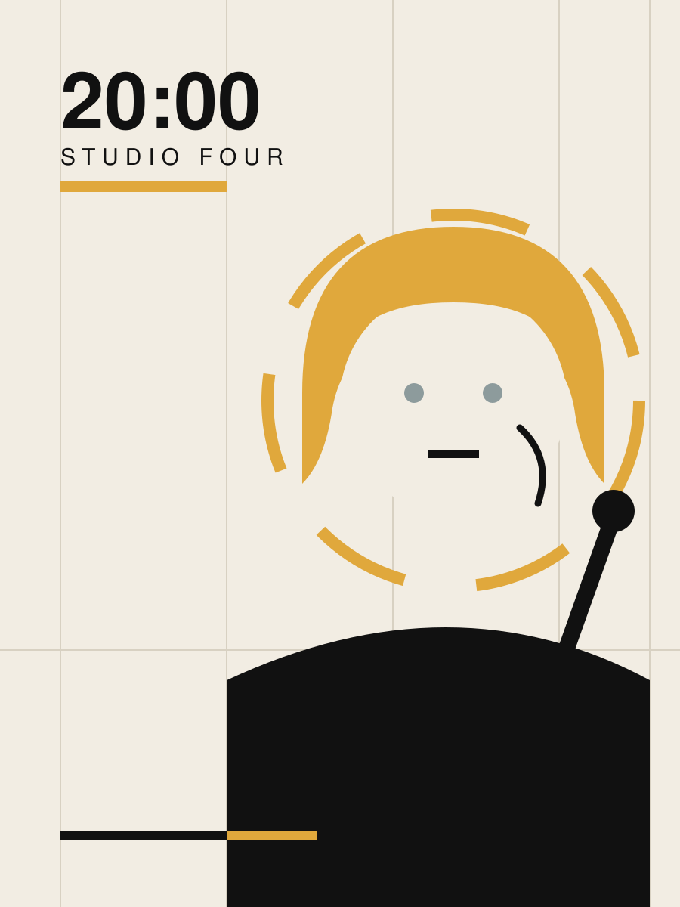
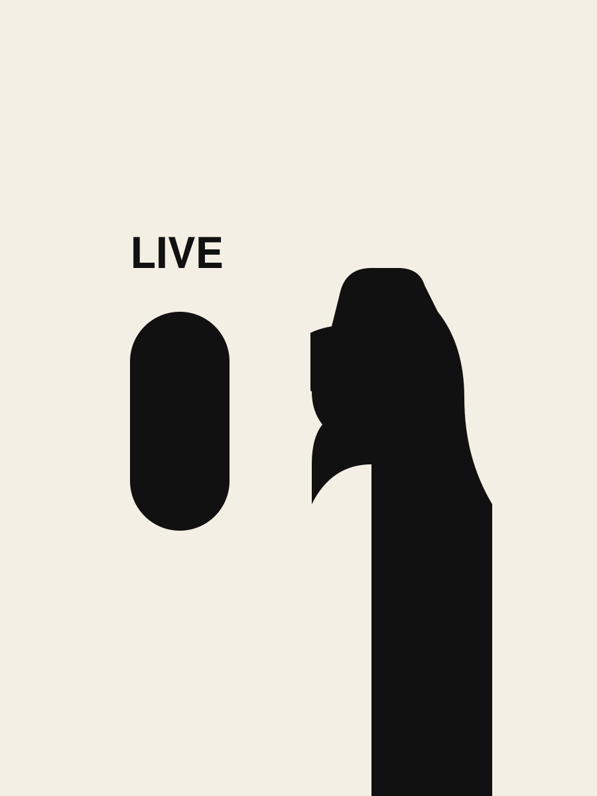
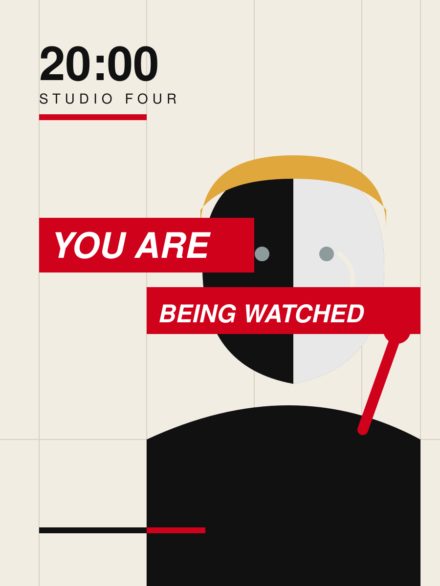

# Test 5: Blonde TV Presenter, On Air

**Skill:** EXPLORE-VISUAL-STYLES v2.3.0

**Canonical task:** [SPEC-003-TV-PRESENTER.md](SPEC-003-TV-PRESENTER.md)  
**Implementation:** [IMPLEMENTATION.md](IMPLEMENTATION.md)  
**Verification:** [REVIEW.md](REVIEW.md) (v2: **8 pass / 3 partial / 0 fail**)  
**Pre-implementation analysis:** [ANALYSIS.md](ANALYSIS.md)

The subject is a blonde female TV presenter with grey eyes, on air. The three studies exercise the references added in this pull request.

## Individual style studies

| Swiss Style | Fukuda negative space | Kruger montage |
| --- | --- | --- |
| [Open SVG](images/01-swiss.svg) | [Open SVG](images/02-fukuda.svg) | [Open SVG](images/03-kruger.svg) |
|  |  |  |

## Hybrid implementation

**V1:** [Original](images/04-hybrid-v1.svg) - bars placed in the outer margin, background uses a gradient; failed AC-06 and AC-07.

**V2:** [Revised image](images/05-hybrid-v2.svg) - bars snapped to the grid columns, flat palette, one bar crossing the face.

The test demonstrates the spec -> implementation -> Acceptance Criteria review loop on the new references. **Full acceptance is not claimed:** AC-01, AC-02 and AC-03 remain partial, mostly because a two-value reference cannot express blonde hair and grey eyes.
