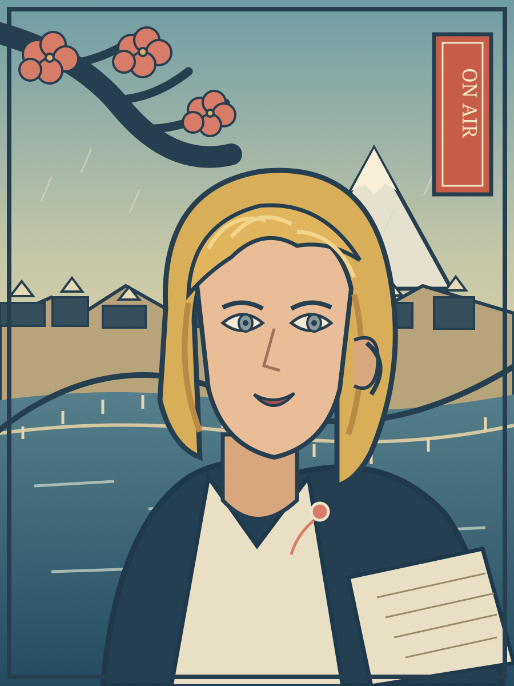
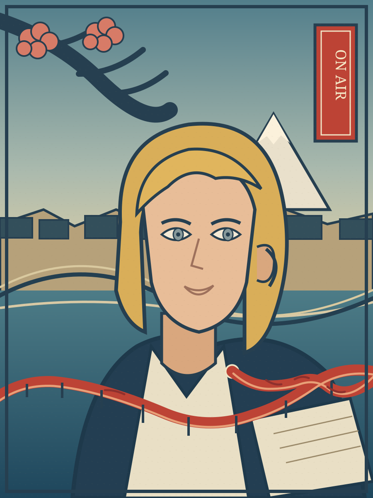

# Test 7: Voice Across the City

**Skill:** [EXPLORE-VISUAL-STYLES 2.3.0](../../../skills/EXPLORE-VISUAL-STYLES.md)  
**Specification:** [SPEC-005-VOICE-ACROSS-THE-CITY.md](SPEC-005-VOICE-ACROSS-THE-CITY.md)  
**Analysis:** [ANALYSIS.md](ANALYSIS.md)  
**Implementation:** [IMPLEMENTATION.md](IMPLEMENTATION.md)  
**Verification:** [REVIEW.md](REVIEW.md)  
**Checklist:** [CHECKLIST.md](CHECKLIST.md)  
**Revision history:** [REVISION-HISTORY.md](REVISION-HISTORY.md)

The fixed subject is a fictional blonde female TV presenter with grey eyes, on air. The test combines [Hiroshige's One Hundred Famous Views of Edo](../../../reference/visual_styles/hiroshige_edo_views/README.md) with [Henryk Tomaszewski's Polish film posters](../../../reference/visual_styles/tomaszewski_film_posters/README.md).

## Individual style studies

| Hiroshige | Tomaszewski |
| --- | --- |
| [Open SVG](images/01-HIROSHIGE.svg) | [Open SVG](images/02-TOMASZEWSKI.svg) |
|  |  |

## Combined result

- **V1:** [Initial hybrid](images/03-HYBRID-V1.svg). The red poster gesture is detached from the microphone and reads as floating decoration.
- **V2:** [Revised hybrid](images/04-HYBRID-V2.svg). The vermilion gesture begins at the lapel microphone, travels across the lower composition and becomes a bridge-like signal path over the river. It stays below the face.

All artwork is original, editable SVG. The test preserves both individual studies, both hybrid iterations, exact design briefs, specification and criterion-by-criterion review.
