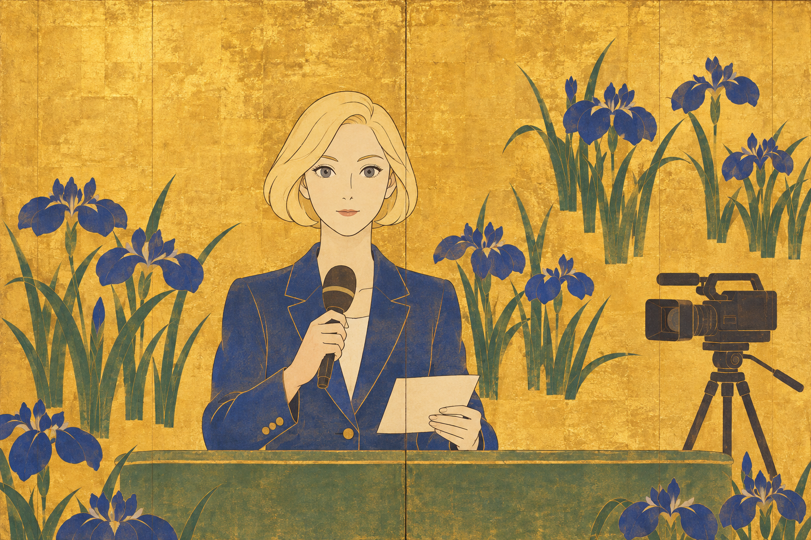
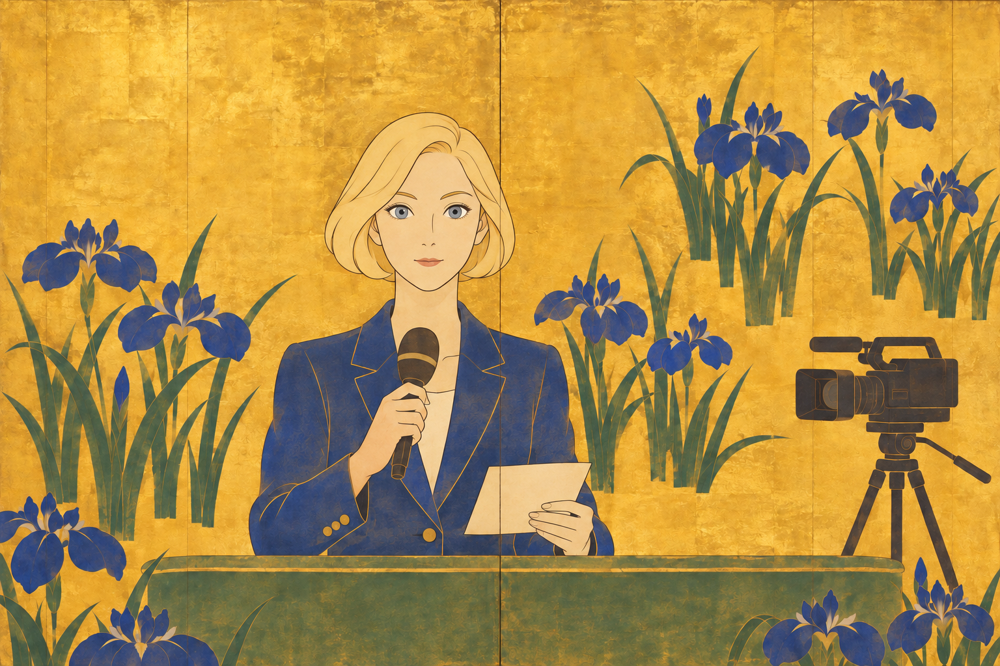
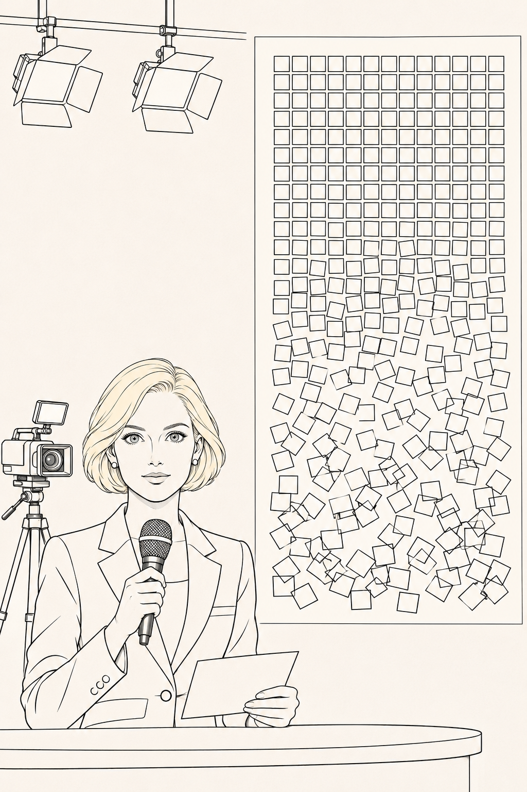
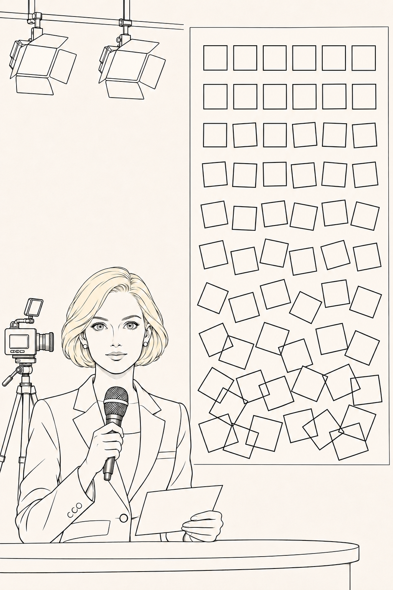
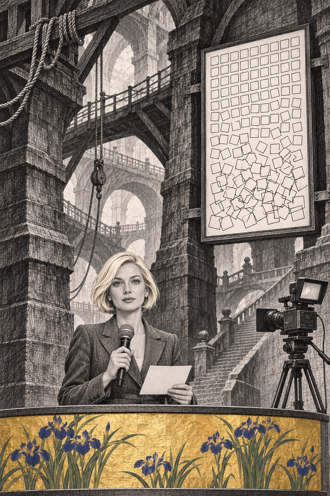
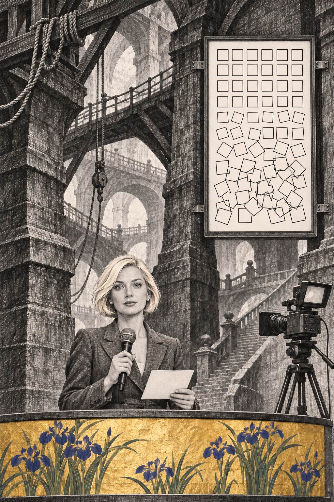

# Test 8: Blonde Television Presenter with Gray Eyes

**Skill:** [Explore Visual Styles v2.3.0](../../../skills/EXPLORE-VISUAL-STYLES.md) ([saved version](snapshots/EXPLORE-VISUAL-STYLES.md)).

**Specification:** [SPEC-006-TV-PRESENTER.md](SPEC-006-TV-PRESENTER.md).

**Inputs:** [exact prompts and image lineage](IMPLEMENTATION.md).

**Review:** [v1](REVIEW-V1.md) → [v2](REVIEW-V2.md).

**Result:** **31 pass / 1 partial / 1 fail**. N1 remains partial in the Nees study and fails in the hybrid; full acceptance is not claimed.

The subject is a fictional adult blonde television presenter with gray eyes. The three references added in PR #4 are tested through separate applications and one combined studio. The previous [documentation audit](../../style_reference_review/REVIEW.md) concerns the reference documents; this folder contains the actual generation experiment.

## Individual Studies: Original and Repeated Result

| Study | Initial result | Revised result |
| --- | --- | --- |
| Piranesi |  |  |
| Korin |  |  |
| Nees application |  |  |

## Hybrid: Original and Repeated Result

| Initial result | Revised result |
| --- | --- |
|  |  |

Piranesi governs the architecture, Korin the gold botanical desk fascia, and Nees the bounded studio display. These scopes and conflicts were defined before generation. The Nees study is also a bounded application: the presenter is outside its abstract field.

## What the Test Demonstrated

The revision clarified gray eyes, corrected the Nees-study camera direction and removed the hybrid display's perspective skew. It did **not** completely preserve equal-size closed squares. Successful changes and remaining defects are documented per criterion.

The package preserves eight PNGs, eight exact prompts, the original and completed spec, source snapshots, implementation settings and [artifact hashes](MANIFEST.json). Generation used the built-in image tool; deterministic pixel-identical reproduction is not claimed.
